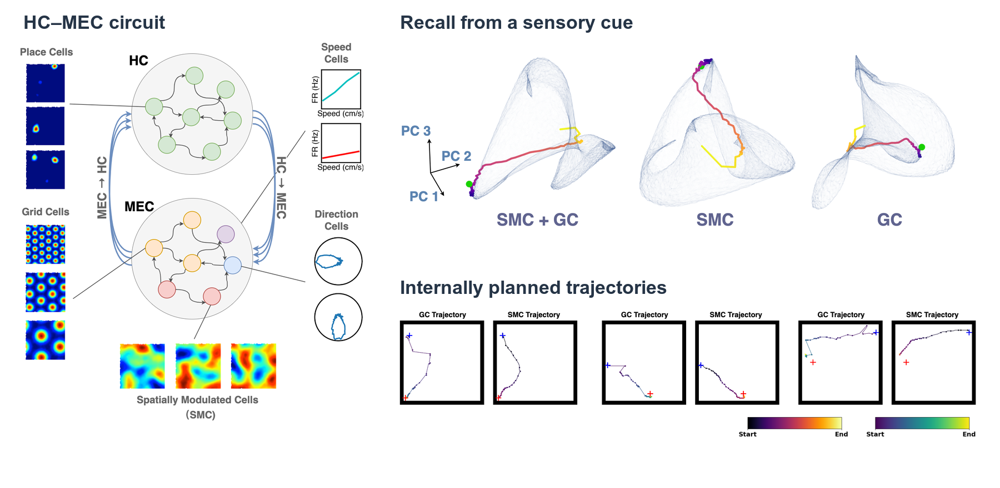

<h1 align="center">REMI: Reconstructing Episodic Memory During Internally Driven Path Planning</h1>

<p align="center">A recurrent model of the hippocampus and medial entorhinal cortex recalls a location from a sensory cue and reconstructs sensory activity along a planned route.</p>

<p align="center">
  <a href="https://arxiv.org/abs/2507.02064"></a>
  <a href="https://zhaozewang.github.io/remi/"></a>
  <a href="demo.ipynb"></a>
</p>

<p align="center">
  
</p>

## About

This repository accompanies our NeurIPS 2025 paper on recall and path planning. During simulated exploration, the network learns to associate sensory observations with grid-cell activity. Given a sensory cue from a familiar location, the circuit can recover the grid pattern for that location. A planner uses the current and target grid patterns to generate a route, and the circuit reinstates the sensory activity associated with positions along the way.

## Setup

Use Python 3.10 or later and a CUDA-capable GPU for the demo. From the repository root, run:

```bash
python -m venv .venv
source .venv/bin/activate
pip install -e .
```

## Run the demo

Train the hippocampal–entorhinal network and collect its firing rate maps:

```bash
python train.py --output-dir artifacts
```

This saves `artifacts/hcmec.pt` and `artifacts/ratemaps.npz`, which the notebook loads. Open the notebook and run its cells in order to visualize the firing fields, test recall from sensory cues, and train the planner:

```bash
jupyter lab demo.ipynb
```
